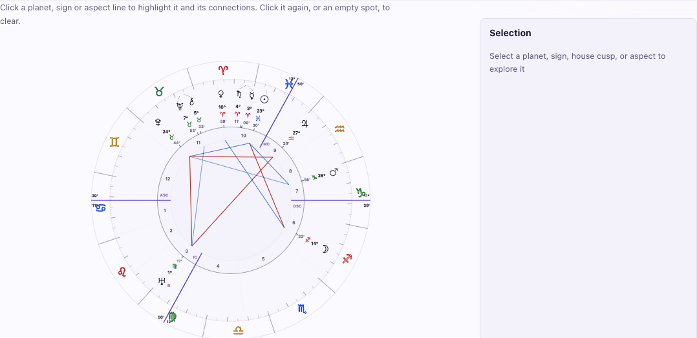
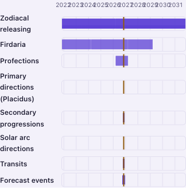
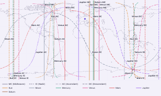
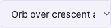

# Astraya UI/UX and design-system audit — 2026-11-08

**Source baseline:** Checked-out source at `e08c3dcd` (`package.json` 0.50.0); no application code changed. The relevant `src/ui`, `src/chart`, and `docs/ui` files match deployed release commit `5893037`. The existing `origin/main` ref is `2eef35a2` (0.51.0), eight commits ahead, with post-release changes to person-navigation order and Overview card spacing; those source changes were inspected but not visually reviewed on that build.

**Runtime baseline:** Authenticated production site, version 0.51.0, commit `5893037`, built 2026-11-08 at 20:39 UTC.

**Reference:** `docs/ui/UI-UX_GUIDELINES.md`, the Charts workspace, `docs/ui/UI-UX_CONFORMANCE_AUDIT_2026-11-05.md`, and current UI enforcement tests
**Scope:** All 35 route kinds in `src/ui/route.ts`, shared page/layout components, UI primitives, `src/ui/app.css`, related source/test/documentation guards, and a multi-route visual review of the authenticated production site

## Executive summary

The Charts page is the app's strongest reference for workflow mechanics: descriptive title, calculation basis, page-level action, labelled chart-type choice, route-backed view navigation, staged settings, and nearby selection feedback. Its responsive workbench has a clear wide/narrow behavior. The rest of the app generally shares the same page header, form, status, and table primitives, but the live visual review found two mobile data-label failures, one accessibility gap in the map's geographic information, and one clipped preference value.

The app has a mature owned design system. Form controls and result tables are centralized, the status-message pattern has an explicit exception list, spacing and coarse-pointer target sizes have enforcement, and most routed screens now use `PageHeader`. The implementation is not fully aligned, however: the guide's chart CSS sample is stale; semantic status colors explicitly alias astrology colors despite the guide forbidding that; the person-navigation implementation exposes Birth record differently from the guide; shared buttons still bypass `Button`; and the main H1 bypasses the declared display token.

**Guide verdict:** The guide is a useful design authority, and its responsive-size matrix and requirement for equivalent structured chart data are correct. It is not yet a reliable line-by-line implementation contract: §2's chart example uses obsolete classes and a nonexistent 64rem shell cap; the person-navigation and state-color implementation diverge from the written rules; typography roles are underspecified. The guide also needs a concrete legibility rule for labels in scaled visualizations. The authenticated production review confirms that the missing acceptance criterion matters at phone width.

## Scope and method

- Traced all 35 route kinds in `src/ui/route.ts`; reviewed shared page shells, primitives, chart layouts, design tokens, guide rules, enforcement tests, and the 2026-11-05 conformance audit.
- Visually reviewed Overview, Birth record, Consultation, all six Charts views, Interpretation, Astrocartography, Transits, Forecast, Timing Timeline, Synastry, six Tools views, PDF Builder, and all three Preferences sections in the authenticated production site. Sampled 390, 768, 1200, and 1440 CSS-pixel widths; reviewed light and dark themes. Used read-only DOM measurements and an accessibility snapshot for the findings below.
- The production About page reports version 0.51.0 / commit `5893037`. The checked-out `e08c3dcd` is its ancestor, and there is no `src/ui`, `src/chart`, or `docs/ui` diff between those two commits. The checkout's existing `origin/main` ref is later than production and contains the named post-release UI changes in the status block above.
- No application data or preferences were changed; only route, viewport, and temporary color-scheme emulation changed. No test suite, lint, or build was run. This is a manual visual review, not a screen-reader, keyboard-only, zoom, or forced-colors sign-off. The 2026-11-03 rendered review at `docs/ui/UI-UX_SPEC_REVIEW_2026-11-03.md` describes an older build and is treated only as historical context.

## Charts as the reference

| Pattern                    | Current implementation                                                                                                                                                                                                      | Verdict                                                                                                                                                                                                           |
| -------------------------- | --------------------------------------------------------------------------------------------------------------------------------------------------------------------------------------------------------------------------- | ----------------------------------------------------------------------------------------------------------------------------------------------------------------------------------------------------------------- |
| Page context and action    | `PageHeader` carries the title, calculation basis, PDF action, and registered page exports (`src/ui/ChartView.tsx:1744-1750`, `src/ui/PageHeader.tsx:20-22`).                                                               | **[SOUND / KEEP]** Reuse the primitive and action contract on calculated pages.                                                                                                                                   |
| Chart type and local views | One Charts destination; chart type is a labelled `ChartTypeSelector`, and the six views are ordinary route links with a narrow-screen `Select` (`src/ui/ChartView.tsx:670-671,1271-1286`, `src/ui/ChartViewNav.tsx:54-90`). | **[SOUND / KEEP]** Route-backed views preserve bookmarks and browser link behavior. Clarify in the guide that the type selector sits immediately before the view-navigation row, rather than inside `PageHeader`. |
| Selection feedback         | The wheel precedes `SelectionInspector` in DOM/focus order (`src/ui/ChartView.tsx:1153-1175`). The query container switches at 68rem to `minmax(46rem, 1fr) minmax(20rem, 24rem)` (`src/ui/app.css:3511-3522,3548-3554`).   | **[SOUND / KEEP]** The implemented threshold, minimum tracks, and owner-approved desktop inner scrolling match the guide's behavioral contract (`docs/ui/UI-UX_GUIDELINES.md:116-136`).                           |
| Chart comparison           | Comparison uses a named class and stacks at the shared 40rem phone breakpoint (`src/ui/ChartView.tsx:1675-1685`, `src/ui/app.css:8348-8357`, `test/ui-comparison-layout.test.ts:11-27`).                                    | **[SOUND / KEEP]** Keep this as a domain-specific layout, not a second generic workbench.                                                                                                                         |
| Reuse beyond charts        | `Button`, field, select, status, disclosure, dialog, and table primitives exist; `PageHeader` is used across route families.                                                                                                | **[SOUND / KEEP]** Reuse the system primitives, not the wheel's unusually dense card/scroll behavior.                                                                                                             |

The chart-type control's _visual grouping_ remains a small specification ambiguity: the guide example places it on the title/basis line, while current source renders it before `ChartViewNav` inside `ChartDataView`. The current implementation is a coherent single control and does not duplicate the choice; update the example to match it or make the header placement explicit before future migrations copy the wrong arrangement.

## Authenticated visual review

The production site keeps a consistent shell and shared control language across the routes reviewed. The Charts workbench remains the best-composed data view: the chart-type Select and route-backed view navigation are distinct, the narrow view navigation collapses to a labelled Select, and the wheel's selection feedback stays adjacent. At the sampled widths, navigation and forms reflowed without document-level horizontal overflow. Forecast and other wide data surfaces keep horizontal scrolling inside their own frames. Dark mode was visually coherent in the sampled screens.

The following findings are from production 0.51.0. Source references point to the matching checked-out UI code at `e08c3dcd`; where the latest local `origin/main` differs, that is called out separately.

### R-01 — P2: Timeline year labels collide on phones

At 390×844, the timeline has a 213px plot column and ten annual labels from 2022 through 2031. Every adjacent pair overlaps by 4–5px; the years merge into one string and cannot be reliably associated with the vertical grid marks. The plot bars and page remain within the viewport, so the defect is confined to the chart axis rather than general overflow.

The component renders every January 1 returned by `yearTicks()` at its proportional x-position (`src/ui/TimingTimelineGantt.tsx:43-55`, `src/ui/timeline-gantt.ts:56-68`). At phone width the responsive grid still reserves 5–7rem for track names and assigns the remaining width to the plot (`src/ui/app.css:8857-8880,8925-8930`); it does not reduce tick density or provide another axis presentation. This fails the guide's 390px responsive review baseline (§10, `docs/ui/UI-UX_GUIDELINES.md:454-464`).

**Correction:** reduce or abbreviate tick labels as available plot width shrinks, or give the axis a readable independently scrollable/minimum-width treatment. Keep the grid-line and label association clear. **Acceptance:** at 390px labels never collide, the year range remains understandable, and the page itself does not gain horizontal overflow.

### R-02 — P2: Astrocartography labels become too small to read on phones

At 390px, the map SVG renders at 325×195px while retaining a 900×538.8 viewBox. Its line labels and embedded legend shrink to roughly 4px high. The map is still visible and the document does not overflow, but the names needed to distinguish individual lines and bodies are not legible at the phone baseline. At 1200px the labels render around 12px and several MC/IC labels cluster tightly at the top and bottom; the measured text boxes do not overlap at that width.

The renderer fixes SVG text size at `width / 75` viewBox units (`src/chart/acg-map.ts:119-145`), while screen CSS scales the complete SVG to the card width (`src/ui/app.css:844-852`). The 390px screenshot therefore scales the 12-unit labels by about 0.36. The guide names 390px as the primary review baseline (§10, `docs/ui/UI-UX_GUIDELINES.md:454-464`) but does not state a minimum label-size or decluttering contract for scaled maps and visualizations.

**Correction:** define a responsive label strategy that preserves legibility without creating collisions—such as a decluttered label set with a full adjacent line list/legend, or a deliberate zoomable map. Do not simply increase all labels until they overlap. **Acceptance:** at 390px a user can identify line and body labels without zooming, or can reach an equally clear alternative in the same view.

The 1200px rendering is available as [desktop map evidence](assets/ui-audit-astrocartography-desktop.png).

### R-03 — P2: Astrocartography has no structured equivalent for its geographic result

The Astrocartography page has no structured list or table describing the geographic paths shown on the map. The disclosures below the map explain astrological meanings, not geography. The map wrapper is explicitly `aria-hidden="true"` (`src/ui/AstrocartographyView.tsx:237-246`), so standards-compliant assistive technology should ignore its text labels and legend. The Playwright accessibility snapshot nevertheless listed the SVG as an image with its 28 body/angle labels and legend; because that conflicts with the explicit hidden state, the snapshot does not establish actual screen-reader exposure. Even if those names are exposed, they do not describe where the curves run. No real screen-reader check was performed.

The page therefore does not meet the guide's explicit chart rule that charts expose equivalent structured data (`docs/ui/UI-UX_GUIDELINES.md:435-448`, especially line 445). The rendered map and separate meanings section are in `src/ui/AstrocartographyView.tsx:235-286`; line geometry and labels are generated in `src/chart/acg-map.ts:119-243`.

**Correction:** add a structured, accessible equivalent for the map's spatial result—at minimum one entry per visible body/angle line with a usable geographic description or coordinates—and keep it synchronized with filters and relocation settings. The existing image and legend can remain as the visual form. **Acceptance:** keyboard and screen-reader users can identify the geography represented by each displayed line, and changing map settings updates both representations together.

### R-04 — P3: Pluto variant value is clipped in Preferences

At 1200×800, the Pluto select is 162.2px wide but its selected option is “Orb over crescent and cross”; the closed control visibly clips the text after “Orb over crescent a”. At 390px the same select widens to 318px and fits. This is a single preference-row constraint, not page overflow, but a user cannot confirm the complete selected variant without opening the native menu.

The Appearance page places the Symbols card beside the Interface card from 1024px (`src/ui/PreferencesView.tsx:402-452`, `src/ui/app.css:8537-8549`). Each symbol row uses a 3:2 text/control split and a full-width Select (`src/ui/app.css:8551-8598`, `src/ui/SymbolSetting.tsx:126-149`), leaving too little width for this label at the tested desktop size.

**Correction:** allow this row's control more width, or give the closed control a concise unique label while preserving the full option text in the menu and an adjacent accessible description. **Acceptance:** the selected Pluto form can be distinguished at 1200px without opening the menu.

### Other rendered observations

- The Charts page's page context, basis, action, and local view navigation form a clear hierarchy. The chart's dense layout should remain a domain-specific workbench rather than become the template for Preferences, Tools, or reading pages.
- The aspect matrix is wider than its phone frame and scrolls inside its own container; the document remains within the viewport. This is a dense-data behavior, not a confirmed guide violation, though a visible affordance may improve discoverability.
- Synastry explains its comparison prerequisites before a second person is chosen; its chart is absent until the input exists. Forecast's tables remain locally scrollable. Interpretation is long but supplies contents links.
- No runtime conclusion is made for admin, sign-in/setup, empty/error/loading states, browser zoom, keyboard-only use, or assistive-technology interaction.

## Guide compliance and exception evaluation

### [UNSOUND / REFACTOR] Verified divergences

| ID   | Finding and evidence                                                                                                                                                                                                                                                                                                                                                                                                                                                                                                                                                                                                                                                                                                                                     | User/engineering impact                                                                                                                                                                                                                               | Required correction                                                                                                                                                                                                                                                                                                                                              |
| ---- | -------------------------------------------------------------------------------------------------------------------------------------------------------------------------------------------------------------------------------------------------------------------------------------------------------------------------------------------------------------------------------------------------------------------------------------------------------------------------------------------------------------------------------------------------------------------------------------------------------------------------------------------------------------------------------------------------------------------------------------------------------- | ----------------------------------------------------------------------------------------------------------------------------------------------------------------------------------------------------------------------------------------------------- | ---------------------------------------------------------------------------------------------------------------------------------------------------------------------------------------------------------------------------------------------------------------------------------------------------------------------------------------------------------------- |
| G-01 | **Chart layout example is stale.** `docs/ui/UI-UX_GUIDELINES.md:138-155` says a 64rem general shell prevents the layout, makes `.chart-workbench` the query container, and styles `.chart-workbench__layout`. Current CSS sets both shell maxima to 80rem (`src/ui/app.css:81-83`), makes `.chart-workbench-shell` the query container, and grids `.chart-workbench` (`src/ui/ChartView.tsx:1155-1156`, `src/ui/app.css:3511-3522`).                                                                                                                                                                                                                                                                                                                     | Contributors following the normative sample will build markup and container selectors that do not match the shipped system; the 64rem rationale is false for this source snapshot.                                                                    | Rewrite the sample with the actual two class names and current 80rem shell facts. State whether the separate wide-shell token is intentionally retained even though it currently equals the general cap.                                                                                                                                                         |
| G-02 | **UI state and astrology color semantics conflict.** The guide says “Astrology colors do not double as UI state colors” (`docs/ui/UI-UX_GUIDELINES.md:500,503`), but the token declarations alias `--color-danger` to `--aspect-hard`, `--color-warning` to `--solar`, `--color-success` to `--aspect-minor`, and `--color-info` to `--aspect-soft` (`src/ui/app.css:50-58,132-145`).                                                                                                                                                                                                                                                                                                                                                                    | A red aspect, a warning, and a destructive action can share the same semantic hue; the source comment itself says the hues are deliberately borrowed. Text and labels help, but token names do not make the visual meanings independent.              | Give semantic state tokens their own theme values, preserving non-color cues; verify contrast in both themes. If the intended product decision is to reuse the same palette, change the guide and record why rather than claiming separation.                                                                                                                    |
| G-03 | **Person navigation does not match the canonical IA table.** The guide places “Edit birth record” under Person details/from Overview and the person selector (`docs/ui/UI-UX_GUIDELINES.md:47-49,60-66`). The deployed header has a persistent Birth record link between Overview and Consultation: `AppNav` pulls Overview and Birth record into its leading group (`src/ui/AppNav.tsx:51-55,122-125`), although `PERSON_TABS` declares Birth record after Consultation (`src/ui/person-nav.ts:40-51`). The existing `origin/main` ref moves Birth record before Overview and records an owner decision in code (`origin/main:src/ui/person-nav.ts:40-51`); the guide still does not specify it as a permanent top-level destination or give its order. | The product navigation exposes a foundational edit destination in a position absent from the canonical IA, and the checked-out code has two different order definitions. The later source changes that position again.                                | Update the canonical IA table to record the owner-approved persistent destination, order, and rationale. Keep the navigation test aligned with the chosen order; the newer `origin/main` already adds an order assertion.                                                                                                                                        |
| G-04 | **The display heading bypasses the type token, and the type contract is incomplete.** `--text-display` is declared at `src/ui/app.css:117-124`, but global H1 uses a different literal clamp at `src/ui/app.css:654-659`. The global section H2 uses literal `1.15rem` at `:668-674`; the `PageHeader` section H2 uses `--text-2xl` at `:8716-8729`. The guide only says to use type tokens (`docs/ui/UI-UX_GUIDELINES.md:496-507`) and never maps H1/H2/H3 to them.                                                                                                                                                                                                                                                                                     | A central display style can drift from its named token, and contributors cannot determine whether the visibly different H2 treatments are deliberate semantic variants or accidental duplication.                                                     | Set a documented heading scale and role-specific variants, wire the H1 to the display token (or make the token match the approved H1), and add a small source guard for shared heading rules. Do not flatten intentionally different section/document heading roles.                                                                                             |
| G-05 | **Shared action buttons remain outside `Button`.** Current non-primitive raw button sites include `PageHeader.tsx:123,162`; `SortableTable.tsx:203,206,212,258`; `PdfAiInterpretationPicker.tsx:155,172,204,215`; `RelationshipSummary.tsx:271,303`; `AppNav.tsx:83,134,239`; plus `PersonSwitcher.tsx:74`, `SyncBadge.tsx:149`, `PwaStatus.tsx:43`, `WorkspaceShell.tsx:39`, `ThemeToggle.tsx:28`, and `LanguageToggle.tsx:25`. The button ratchet only enumerates selected route screens (`test/ui-primitive-enforcement.test.ts:119-167`); shared controls above are outside it.                                                                                                                                                                      | Shared controls can diverge in target sizing, focus/disabled treatment, and variants even while the selected route-screen ratchet passes. The buttons are semantically real buttons; the issue is inconsistent primitive ownership, not invalid HTML. | Migrate shared action/dropdown/sort buttons to `Button` with the appropriate `plain`/compact styling, preserving behavior and accessible names. Keep the recorded owner exceptions for language/theme/symbol/sidebar toggles only if their custom appearance is intentional; expand the ratchet to cover all remaining shared modules with a reasoned allowlist. |
| G-06 | **Backdrop color is duplicated as a component literal.** Both `.settings-card::backdrop` and `.signin-card::backdrop` use `rgb(0 0 0 / 0.45)` (`src/ui/app.css:6217-6219,6640-6642`), despite the guide's component-token rule (`docs/ui/UI-UX_GUIDELINES.md:502,507`).                                                                                                                                                                                                                                                                                                                                                                                                                                                                                  | A future backdrop adjustment can change only one dialog family and leave modal dimming inconsistent across the app.                                                                                                                                   | Add one semantic backdrop token and reference it from both rules; test light/dark and modal contrast.                                                                                                                                                                                                                                                            |
| G-07 | **The shell-width distinction is currently a no-op, and its comments are stale.** `--shell-max-width` and `--shell-max-width-wide` are both 80rem (`src/ui/app.css:79-83`), so `.shell--wide` does not widen the shell (`:644-652`). The guide still says the general cap is 64rem (`docs/ui/UI-UX_GUIDELINES.md:138`); the chart E2E rationale repeats that at `e2e/chart-workbench.spec.ts:640-641`, then calls the grid 7fr/5fr at `:671-674` although the assertions and CSS use minimum track sizes.                                                                                                                                                                                                                                                | The rendered behavior is clear, but stale explanations obscure why the marker/token exists and mislead maintainers reviewing responsive breakpoints.                                                                                                  | Choose one policy: restore a genuinely narrower prose/general shell and keep the wide modifier, or consolidate the equal tokens and update comments/tests. Rewrite E2E comments to describe the actual 46rem/20–24rem contract.                                                                                                                                  |

### [SOUND / KEEP] Documented or technically justified exceptions

| Exception                                          | Evidence                                                                                                                                                                                                                                                                                                         | Verdict                                                                                                                                                       |
| -------------------------------------------------- | ---------------------------------------------------------------------------------------------------------------------------------------------------------------------------------------------------------------------------------------------------------------------------------------------------------------- | ------------------------------------------------------------------------------------------------------------------------------------------------------------- |
| Chart/map colors and inline geometry               | §11 explicitly exempts chart/map geometry (`docs/ui/UI-UX_GUIDELINES.md:503`). The data-driven inline styles are bounded to resized table columns, matrix column count, and timeline tick position (`src/ui/SortableTable.tsx:230-235`, `src/ui/AspectMatrixGrid.tsx:133`, `src/ui/TimingTimelineGantt.tsx:51`). | Keep. These values encode data geometry, not reusable UI state or arbitrary feature styling.                                                                  |
| Free-form year/coordinate entry and range controls | The guide records text-field exceptions for years and decimal coordinates and allows range sliders (`docs/ui/UI-UX_GUIDELINES.md:368-369`; `test/ui-primitive-enforcement.test.ts:1-39`).                                                                                                                        | Keep. Shared field anatomy remains; text input preserves decimal/free-form entry, and range is a distinct visualization control.                              |
| Status rows that are not result messages           | `StatusMessage` is the shared status primitive (`src/ui/primitives/StatusMessage.tsx:3-42`). Popup/listbox rows and specialized save/export/sync/update announcements are recorded and allowlisted (`docs/ui/UI-UX_GUIDELINES.md:411-418`, `test/ui-status-message.test.tsx:75-120`).                            | Keep the narrow exceptions; keep the ratchet and shrink the allowlist when a case becomes a normal result-state message.                                      |
| Chart inspector internal scrolling                 | The guide explicitly accepts desktop internal scrolling to preserve the dial's fold and keeps the inspector in document flow below 68rem (`docs/ui/UI-UX_GUIDELINES.md:130`); CSS implements the same (`src/ui/app.css:3522-3545`).                                                                              | Keep as an owner-approved chart-specific tradeoff, not a general card pattern. Browser-check keyboard access to the inner scroll region on the current build. |
| Table density and responsive table frame           | Fine-pointer cell padding is the one spacing exception in the ratchet (`test/ui-primitive-enforcement.test.ts:42-65`); table scrolling and edge cues are shared (`src/ui/SortableTable.tsx:219-229`, `src/ui/app.css:2311-2382`) and explicitly specified in §5 (`docs/ui/UI-UX_GUIDELINES.md:339`).             | Keep. It serves dense numeric data while preserving a named keyboard-scroll region and coarse-pointer sizing.                                                 |
| Unequal side panels on selected tasks              | PDF builder, Primary Directions, Profections, and Horary exceptions are documented with rationale and scope in §10 (`docs/ui/UI-UX_GUIDELINES.md:475-477,494`).                                                                                                                                                  | Keep those named exceptions; do not use them to waive the layout rule on unrelated pages.                                                                     |
| Print-only black/white                             | `src/ui/app.css:5078-5083` forces contrast for print output.                                                                                                                                                                                                                                                     | Keep; print substrate overrides are not screen-theme token bypasses.                                                                                          |

## Findings by requested dimension

1. **Guide adherence:** partial, not strict. Behavioral contracts and explicit exception records are generally clear; G-01, G-02, and G-03 are the material contract conflicts. G-04 leaves typography under-specified.
2. **Design system and reuse:** strong shared field, select, button, status, dialog, disclosure, badge, and table primitives exist (`src/ui/primitives/`). Raw fields/dialogs are blocked outside primitives except the documented range control (`test/ui-primitive-enforcement.test.ts:1-39`). Shared raw buttons remain as G-05. There is no generic `Card` primitive; do not introduce one merely to flatten chart, admin, and form-specific structures—first consolidate only demonstrably identical surface anatomy.
3. **Typography and hierarchy:** shared page-header hierarchy is widely adopted, and top-level H1 is centralized, but its size bypasses `--text-display`; heading roles are not specified as a token mapping (G-04). Current title-specific variants may be intentional; the missing contract makes strict parity untestable.
4. **Layout and spacing:** the chart workbench has a container query and exact geometry tests; comparison layout is a named responsive class. Text-heavy content has a separate prose measure (`--prose-measure:75ch`, `src/ui/app.css:84-87`). The `shell--wide` token is presently the same width as the general shell (G-07), so its name and rationale overstate the actual width difference. The CSS token comment calls the scale a “4px spacing grid” (`src/ui/app.css:99`), while the guide correctly calculates 3.5 CSS pixels from the 14px root (`docs/ui/UI-UX_GUIDELINES.md:499`); correct the comment, not the documented arithmetic.
5. **Forms and filters:** control height, field anatomy, disabled/focus states, and responsive coarse-pointer sizing are centralized; raw inputs/selects/dialogs are guarded. Search/filter arrangements may differ by task, but the corpus editor's two-row filter is a named feature layout, not a duplicate generic form primitive. Keep the documented free-form numeric exceptions.
6. **Feedback and states:** `StatusMessage`, `Notice`, and `EmptyState` distinguish changed result state from persistent explanatory content. Status roles and busy state are centralized; narrow non-result exceptions are tested. Controls have shared focus/disabled styling and a 24px fine-pointer / 44px coarse-pointer target token (`src/ui/app.css:8188-8204`). These are source/test strengths, not a claim that every current rendered state was visually checked.
7. **Color and theme:** light/dark token sets and semantic aliases are centralized, but G-02 contradicts the guide's “independent of astrology meaning” rule. G-06 is the remaining duplicated screen-component color. Map/chart geometry, token definitions, and print-only values are not violations.
8. **Navigation and micro-interactions:** Charts correctly uses one route destination and ordinary route links; local route links are not misrepresented as ARIA tabs. Section tabs and tool tabs have shared frames. The Birth record placement diverges from the canonical table (G-03). Current `AppNav.tsx` also contains stale top comments describing Charts as a chart-type dropdown and `ChartView` as the only export registrar (`src/ui/AppNav.tsx:5-17`), while its actual code says the selector is page-level (`:48-55`).
9. **Information architecture and density:** routed data tables use shared `SortableTable`; source scan found no standalone `<table>` implementations elsewhere in `src/ui`. Numeric/data geometry uses alignment metadata and controlled resizing; table export/sort/reset actions are part of the shared component. The remaining raw table buttons are covered under G-05. Runtime review found no page-level overflow in the sampled screens, but the timeline axis fails at 390px (R-01). The ACG map has no structured geographic equivalent; its SVG wrapper is `aria-hidden`, while the Playwright snapshot's apparent exposure conflicts with that source state. Treat it as an accessibility risk that requires real AT validation (R-03), and add the equivalent data required by §9.

## Additional implementation-documentation drift

These do not independently change the rendered interface, but make the intended system harder to maintain:

- `src/ui/PageHeader.tsx:10-12` says `ChartView` is the only export registrar; current registrars also include `PreferencesView`, `EventSearchView`, `CorpusOverridesPanel`, and `SortableTable` (`rg useRegisterExports src/ui`).
- `src/ui/PageHeader.tsx:66-67` says every existing page omits subtitles; current callers include Preferences, PDF Builder, and Astrocartography.
- `src/ui/app.css:99` calls the spacing grid 4px, contrary to the correct 3.5px calculation in the guide.
- `e2e/chart-workbench.spec.ts:640-641,671-674` has stale width/split commentary; the assertions below those comments still check the 68rem breakpoint and 46rem / 20–24rem tracks.
- `src/ui/AppNav.tsx:5-17` has outdated chart dropdown/export-registration prose that conflicts with its current implementation and later comments; the same stale chart-description text remains in the existing `origin/main` ref.

## Component consolidation plan

| Priority | Consolidation                                                                                                    | Scope                                                                                                                                                                                                                      |
| -------- | ---------------------------------------------------------------------------------------------------------------- | -------------------------------------------------------------------------------------------------------------------------------------------------------------------------------------------------------------------------- |
| 1        | Finish `Button` ownership for shared actions, sort triggers, dropdown triggers, and plain close/update controls. | `PageHeader`, `SortableTable`, `PdfAiInterpretationPicker`, `RelationshipSummary`, `AppNav`, `PersonSwitcher`, `SyncBadge`, and `PwaStatus`; preserve native semantics and custom class hooks.                             |
| 2        | Complete the token contract for type and modal backdrops.                                                        | Semantic H1–H3 roles plus display token; one backdrop token for settings/sign-in dialogs; state hues independent of astrology meanings.                                                                                    |
| 3        | Keep current high-value composites as the reusable layer.                                                        | `StatusMessage`, `SortableTable`, `PageHeader`, `Tabs`, `Disclosure`, `StagedDialog`, `SelectionInspector`, and form primitives. Do not duplicate these in feature views.                                                  |
| 4        | Do not consolidate unlike cards prematurely.                                                                     | Keep wheel inspector, settings drawers, data panels, and admin editors purpose-built. Extract a card primitive only if a follow-up audit proves repeated identical markup/behavior, not merely similar rounded rectangles. |

## Prioritized refactor tasks

1. **P1 — Repair the guide's chart contract.** Replace §2's 64rem claim and obsolete class sample with the current container/grid markup; document the current shell width policy and chart-type-control placement. Acceptance: a contributor can implement the guide sample verbatim and get the tested 67.99rem/68rem behavior.
2. **P1 — Separate state color semantics.** Define independent state values in both themes and remove aliases from astrology hues. Acceptance: no semantic state token resolves to an aspect, element, ring, or solar chart token; visible state remains understandable without color and passes contrast checks.
3. **P2 — Decide the Birth record destination.** Align `PERSON_TABS`/`AppNav` with the canonical guide, or revise the guide with the explicit owner rationale. Acceptance: one documented order, one route behavior, and navigation tests matching it.
4. **P2 — Finish shared button migration and its guard.** Move remaining shared action buttons to `Button`; retain narrowly approved shell exceptions in a named allowlist. Acceptance: every non-primitive UI `<button>` is either `Button` or individually justified, and a new raw shared button fails a test.
5. **P2 — Make typography implementable.** Map heading roles to existing/new type tokens and align global H1 with `--text-display`. Acceptance: shared page/section headings use documented roles; feature-specific visualization labels remain explicit exceptions.
6. **P3 — Clean visual-token and shell drift.** Add a backdrop token, resolve equal shell-max tokens, correct the spacing-grid comment and stale AppNav/PageHeader/E2E prose. Acceptance: current comments describe current selectors, values, and owners; guide and CSS agree.
7. **P2 — Fix responsive visualization labels.** Address the phone-width Timeline axis collisions (R-01) and Astrocartography label scale (R-02). Acceptance: at 390×844 no year labels collide, line/body names remain legible or have an equally clear in-view alternative, and neither screen introduces document-level horizontal overflow.
8. **P2 — Expose Astrocartography geography as structured data.** Add a text/list/table equivalent for the visible line paths that tracks the applied filters and relocation state (R-03). Acceptance: assistive-technology users can identify the geographic information represented by each displayed line.
9. **P3 — Preserve selected values in constrained preference rows.** Widen or shorten the Pluto variant's closed value without losing the full option and description (R-04). Acceptance: the selected variant is distinguishable at 1200px.
10. **P2 — Complete manual accessibility and visual sign-off.** Inspect keyboard-only flow, focus return, zoom, screen-reader announcements, inspector scrolling, modal behavior, long tables, and admin/authenticated states on the build being released. Acceptance: record owner verdicts using `docs/ops/VISUAL-REVIEW.md` and `docs/ui/UI-UX_RELEASE_CHECKS.md`; do not use the 2026-11-03 rendered audit as a current pass.

## Bottom line

Keep Charts as the reference for page context, route-backed view navigation, staged configuration, and adjacent selection feedback. The guide is right about the overall direction, responsive review sizes, and the need for equivalent structured chart data. It is not ready as a strict pass/fail implementation contract until its stale chart example, undocumented navigation choice, incomplete heading contract, and source/token conflicts are resolved. Add an explicit visual-label legibility criterion. The production review found that the app is broadly coherent, with focused fixes needed for mobile timeline and map labels, map accessibility, and one clipped preference value. The source and runtime versions are identified separately above so the live results are not mistaken for an unreviewed post-release build.
